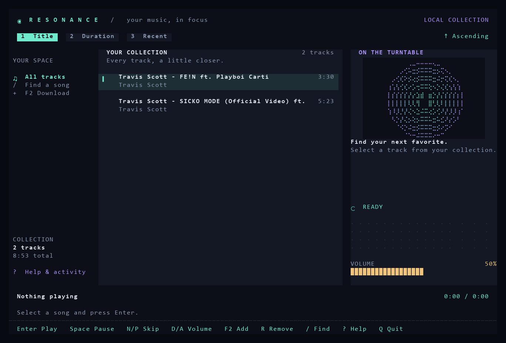

# Resonance · Terminal Music Player

A **Windows x64 music player** built with **C++17**, **FTXUI**, and **BASS**.
Search for songs by title and artist, download them, and listen offline in a
terminal interface with a live audio spectrum.

This college project demonstrates custom **AVL trees**, **hash maps**, and a
**doubly linked playlist** in a complete application.



## Features

- Local playback, pause/resume, volume control, seeking, and automatic advancement.
- Sorting by title, duration, or order added, in either direction.
- Filtering by title or artist without interrupting playback.
- Background YouTube downloads with progress and cancellation.
- Song deletion with confirmation and consistent index updates.
- BASS FFT spectrum, RGB theme, mouse selection, and compact terminal layout.
- Validated metadata, atomic saves, backups, and actionable error messages.

## Build and run

Required: **Windows x64**, **MinGW-w64 GCC with C++17 support**, **CMake 3.21+**,
**Ninja**, and **Git** on PATH. The verified compiler is GCC 12.2.
The matching x64 BASS header, import library, and DLL are included.
The first configuration needs internet access to fetch **FTXUI v6.1.9**.

From the project folder in PowerShell:

```powershell
git clone https://github.com/WarMachine108/Music-player.git
cd Music-player
cmake --preset windows-mingw
cmake --build --preset windows-mingw
.\build\music_player.exe
```

Alternatively, `runmusicplayer.bat` configures, builds, and launches the player.
CMake copies BASS and the MinGW runtime DLLs beside the executable. All generated
build files stay in the ignored `build/` folder.

Use **Windows Terminal** at **120 × 40** for the full layout. The minimum size
is **72 × 24**. Rust, WSL, and Sixel are not required. Do not mix compilers in
one build directory; MSVC needs its own x64 build directory and generator.

## Downloader setup

The application expects these files in `Header_Files/ytdl/`:

```text
yt-dlp.exe    ffmpeg.exe    ffprobe.exe    deno.exe
```

They are local runtime tools, excluded from Git. To install/update **yt-dlp**
and **Deno** from official releases with SHA-256 verification:

```powershell
powershell -NoProfile -ExecutionPolicy Bypass -File scripts/setup-downloader.ps1
```

The script installs inside this project and leaves FFmpeg unchanged. It retains
a previous downloader copy in `build/`; that cache may be deleted afterward.
Deno is pinned to v2.9.8; `-DenoVersion` selects a different release.

If FFmpeg is missing, follow the Windows build links on
[FFmpeg's download page](https://ffmpeg.org/download.html) and place
`ffmpeg.exe` and `ffprobe.exe` in the tools folder.

Downloads select the first YouTube search result. Listening remains available
while downloading. Esc cancels the process tree; quitting cancels and waits for
cleanup. Operations time out after ten minutes. YouTube restrictions, network
problems, or extractor changes may require a tool update. Only download audio
you are permitted to use.

## Controls

| Key | Action |
|---|---|
| Up/Down, Page Up/Down, Home/End | Browse songs |
| Enter | Play selected song |
| Space or S | Pause/resume |
| N / P | Next / previous track |
| D / A or + / − | Adjust volume by 5% |
| Left / Right | Seek 5 seconds |
| 1 / 2 / 3 | Sort by title / duration / order added |
| X | Reverse sort order |
| / | Filter by title or artist; Enter applies |
| Esc | Close dialog, cancel download, or clear filter |
| F2 | Download a song |
| R or Delete | Remove selected song; Y confirms, N/Esc cancels |
| F5 | Reload library metadata |
| ? or F1 | Help and recent activity |
| Q | Quit |

Click a song to select it; the mouse wheel moves the selection. Sorting preserves
the current track, playback position, and pause state. Filtering affects only
the visible list; next/previous follows the full sorted playlist. Manual
navigation stays at playlist boundaries. Natural completion advances to the
next available track, then stops at the end without closing the application.

Deleting a playing track continues with its neighbor. Deleting a paused track
leaves playback stopped. The vinyl illustration is generated terminal art;
the spectrum uses actual audio data rather than a decorative animation.

## Project structure

```text
Music-player/
├── main.cpp                 Application entry point
├── CMakeLists.txt           C++17 build and dependencies
├── CMakePresets.json        Windows MinGW presets
├── runmusicplayer.bat       Build-and-run shortcut
├── bass.dll                 BASS audio runtime
├── Header_Files/
│   ├── preprocessing.hpp    Custom AVL implementation
│   ├── maker.hpp            Library indexes and linked playlist
│   ├── bassplayer.hpp       Playback, position, volume, and FFT
│   ├── ui.hpp               FTXUI layout, dialogs, and controls
│   ├── downloader.hpp       Staged download and library commit
│   ├── process.hpp          Windows subprocesses and cancellation
│   ├── storage.hpp          Metadata validation and safe saves
│   ├── bass.h / bass.lib    BASS SDK files
│   ├── json.hpp             nlohmann/json
│   └── ytdl/                Local downloader executables
├── Info_files/info.json     Song metadata
├── audioloc/                Downloaded MP3s and existing artwork
├── scripts/                 Tool setup and screenshot utility
├── docs/screenshot.png      Interface preview
└── build/                   Generated output (ignored)
```

## Data structures and persistence

- **Hash map:** song ID → metadata for expected O(1) lookup.
- **Title AVL:** `(case-folded title, ID)` keys preserve distinct songs with
  identical titles.
- **Duration AVL + hash groups:** order durations and retain equal-length songs.
- **Vector:** tracks insertion order for recent sorting.
- **Doubly linked list:** stores the current playback order.

AVL insertion/removal is O(log n). Ordered playlist construction is O(n), plus
secondary sorting within equal-duration groups. Adjacent-node traversal is
O(1); resolving the current ID into the list is O(n). Title folding ignores
ASCII case; non-ASCII text is displayed as UTF-8 and compared bytewise.

`Info_files/info.json` contains an array of `{id, title, uploader, duration}`.
Integer and legacy integer-string durations are accepted. Audio lives at
`audioloc/<id>.mp3`; existing artwork is kept until its song is removed.
These library files are local data excluded from Git. A fresh clone starts
with an empty collection; the application creates the data folders when needed.

Missing metadata starts an empty library. Malformed JSON is never reset
automatically. Invalid individual entries are reported, and editing is disabled
until they are repaired. Duplicate IDs load once with a warning. Saves create
`info.json.bak`, use a temporary file and Windows replacement, and reject stale
concurrent writes. F5 reloads external edits.

Downloads are staged in `.downloads/` and committed only after success. Existing
audio is never overwritten silently. Media deletion follows a successful metadata
save; a locked file may remain as an orphan and produces a warning. Normal
failure/cancellation cleans staging files; a forced shutdown may leave leftovers.

Paths are resolved from the project/executable rather than the shell's working
directory. To use a separate library:

```powershell
.\build\music_player.exe --root "C:\Music Library"
```

That directory also needs `Header_Files/ytdl/` for downloading. Windows
wide-character APIs support Unicode paths.

## Interface screenshot

To regenerate the interface image, install Pillow for this optional utility:

```powershell
.\build\music_player.exe --snapshot build/ui.ansi
python scripts/render_snapshot.py build/ui.ansi docs/screenshot.png
```

## Third-party components

FTXUI and nlohmann/json use the MIT license. BASS has separate
[noncommercial licensing terms](https://www.un4seen.com/bass.html).
yt-dlp, FFmpeg, and Deno retain their upstream licenses.
